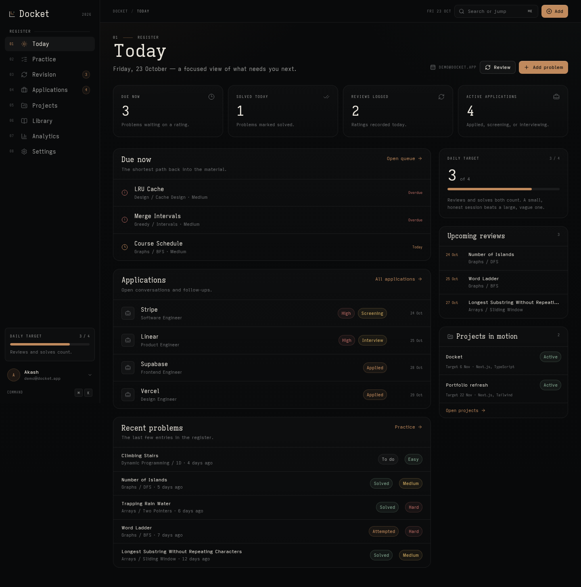
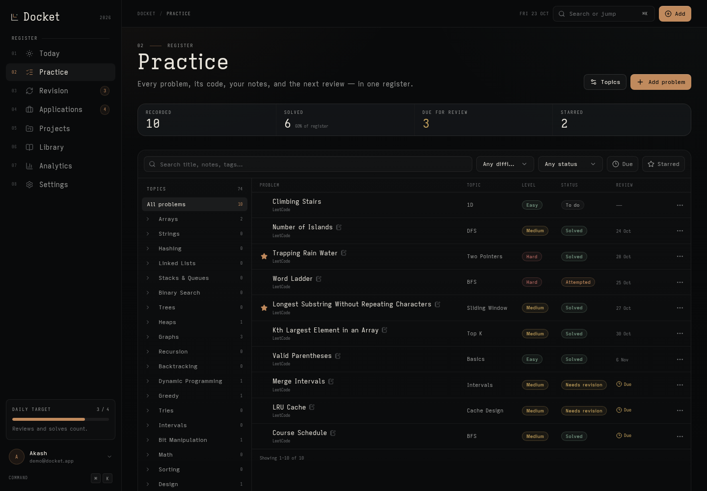
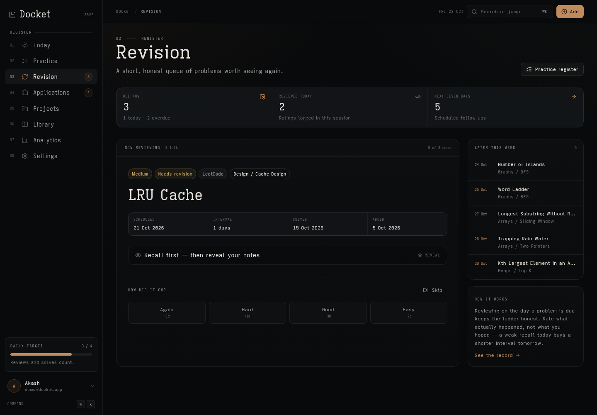
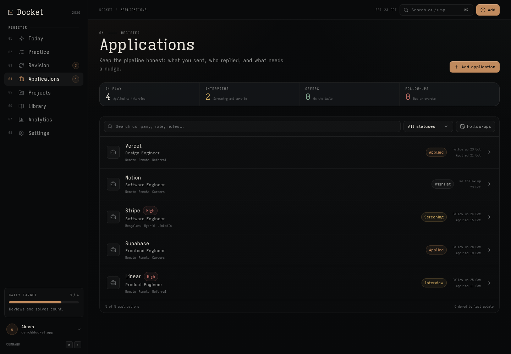
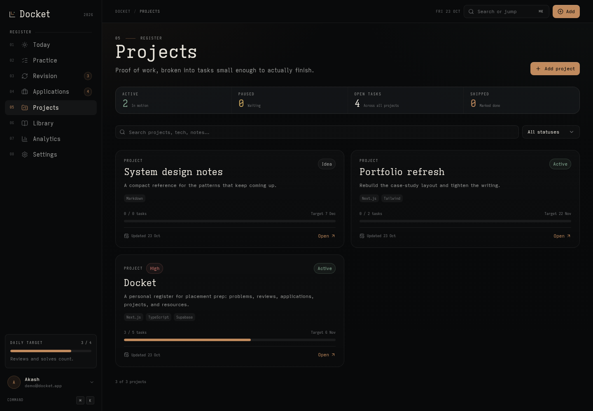
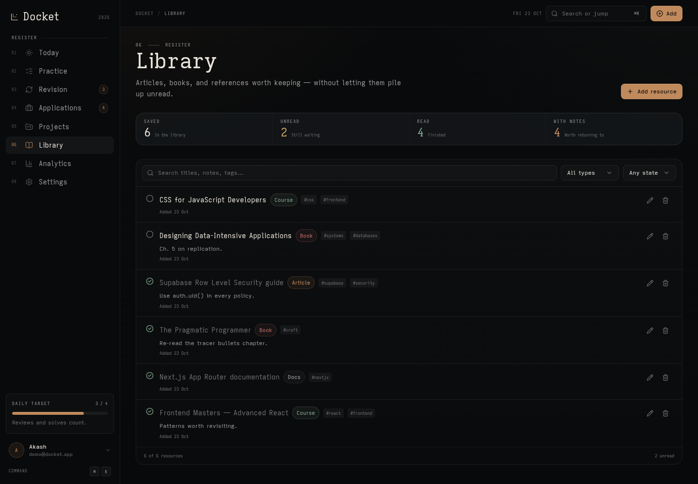
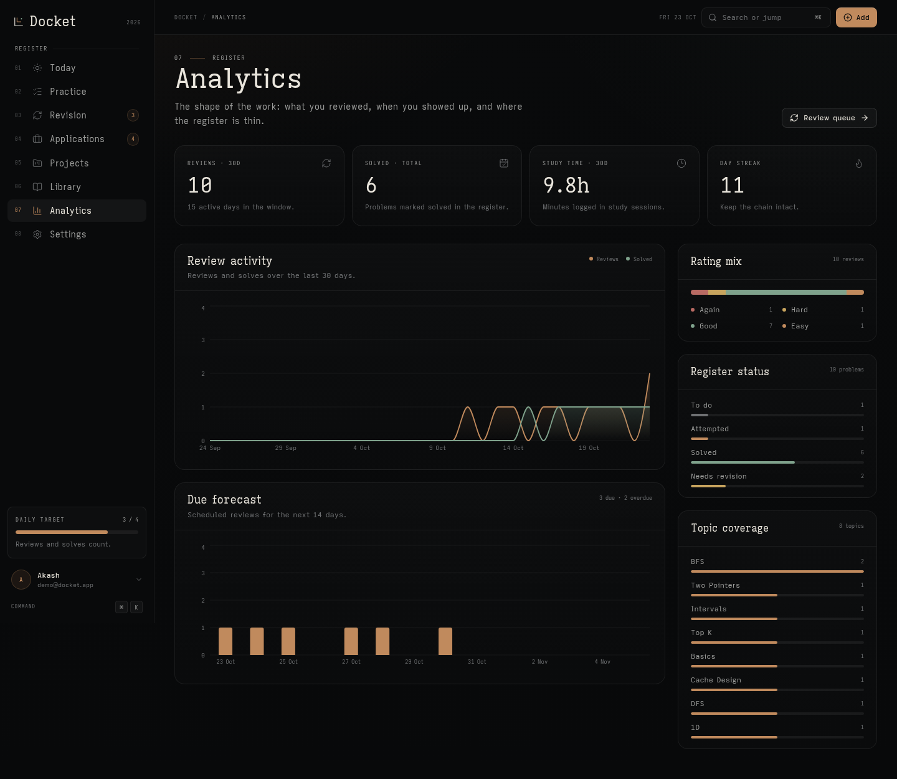
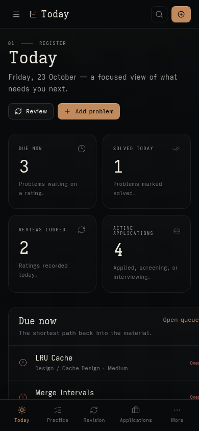

# Docket

A personal placement-prep register: practice problems, spaced revision, job applications, side projects, and a reading library in one focused workspace.

[Live app](https://tracker.akakash.me) · [Screenshots](#screenshots)



## Features

- **Today** — due reviews, solved today, reviews logged, active applications, daily target, upcoming reviews, and projects in motion.
- **Practice** — a searchable problem register with topics, difficulty, status, notes, code, tags, and per-problem review schedules.
- **Revision** — a focused review queue with reveal, rating, skip, and upcoming review counts.
- **Applications** — track roles from wishlist through offer, with follow-ups, contacts, job events, and pipeline stats.
- **Projects** — project status, target dates, tech stacks, and task boards.
- **Library** — saved articles, books, courses, and docs with read state and notes.
- **Analytics** — 30-day activity, due forecast, rating mix, register status, topic coverage, and streaks.
- **Settings** — display name, daily target, timezone, password change, JSON export, and sign out.
- **Private by default** — Supabase Auth plus row-level security scopes every record to its owner.

## Screenshots

Screenshots use seeded demo data. The demo account is removed after capture.

| Today | Practice |
| --- | --- |
|  |  |

| Revision | Applications |
| --- | --- |
|  |  |

| Projects | Library |
| --- | --- |
|  |  |

| Analytics | Mobile |
| --- | --- |
|  |  |

## Stack

- **Framework:** Next.js 16 (App Router, Turbopack), React 19, TypeScript
- **Styling:** Tailwind CSS 4, Radix UI, Iosevka typefaces
- **Data:** Supabase Postgres, Auth, and Row Level Security
- **Charts:** Recharts
- **Editor:** CodeMirror 6
- **Tests and tooling:** Vitest, Playwright, ESLint, Prettier

## Local development

### 1. Create the database

Create a Supabase project, then run [`supabase/migrations/20261021000001_init.sql`](supabase/migrations/20261021000001_init.sql) in the SQL editor. The migration creates the tables, indexes, row-level security policies, and the profile/topic setup trigger.

Under **Authentication → URL Configuration**, set:

- **Site URL:** `http://localhost:3000`
- **Redirect URLs:** `http://localhost:3000/**`

Email confirmation is enabled by default. Confirm your account before signing in.

### 2. Configure environment variables

```bash
cp .env.example .env.local
```

Fill in the Supabase project URL and publishable key from **Project Settings → API**. The app only needs the public Supabase credentials; never expose a service-role key to the browser.

### 3. Run the app

```bash
npm install
npm run dev
```

Open [http://localhost:3000](http://localhost:3000).

## Scripts

| Command | Description |
| --- | --- |
| `npm run dev` | Start the development server |
| `npm run build` | Create a production build |
| `npm run start` | Serve the production build |
| `npm run lint` | Run ESLint |
| `npm run typecheck` | Run the TypeScript compiler |
| `npm run test` | Run Vitest |
| `npm run check` | Lint, typecheck, and test |

## Deploying

The app is deployed on Vercel at [tracker.akakash.me](https://tracker.akakash.me). To deploy your own copy:

1. Import the repository into Vercel.
2. Add `NEXT_PUBLIC_SUPABASE_URL`, `NEXT_PUBLIC_SUPABASE_PUBLISHABLE_KEY`, and `NEXT_PUBLIC_SITE_URL` for Production.
3. Optionally set `ALLOWED_SIGNUP_EMAILS` to a comma-separated allowlist for a private instance.
4. In Supabase **Authentication → URL Configuration**, set the Site URL and redirect URL to your production domain.
5. Deploy.

The app does not need the database password, service-role key, or JWKS URL at runtime. Authentication uses Supabase publishable keys and the signed JWT claims.

## Project structure

```text
src/
  app/                 App Router pages and route handlers
  components/          Shared shell and UI primitives
  features/            Domain modules: analytics, auth, dashboard,
                       dsa, jobs, projects, resources, revision, settings
  lib/                 Supabase clients, auth, date/text utilities
supabase/migrations/   Database schema and RLS policies
docs/screenshots/      Screenshots used in this README
scripts/               Local Playwright screenshot helper
```
